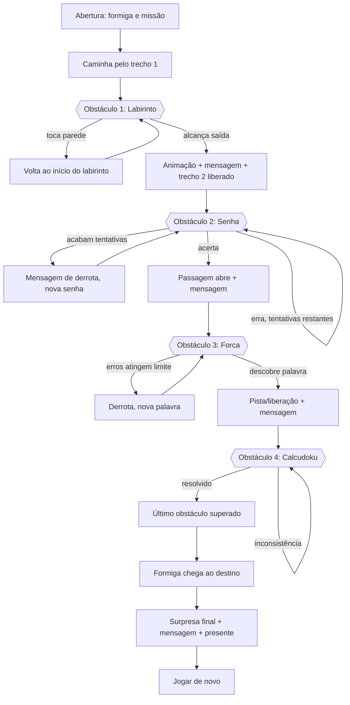

# PRD v2 — A Aventura da Formiga (reformulação)

Versão: 2.0 — rascunho para validação. Substitui `PRD.md` (v1) e `PLANO-EXECUCAO.md` assim que aprovado.
Nenhum código foi alterado para produzir este documento.

---

## 0. Decisões validadas (rodada 1)

| Tema | Decisão |
|---|---|
| Marca "ToH" | Sai do peitoral da Peteca (editar as 3 imagens antes da integração). |
| História | Mantém o universo do v1: busca pelo lendário Leite, Piauí/Maranhão, Peteca, mensagem da cliente. |
| Destino e surpresa | Inalterados: encontro com o Leite, mensagem final da cliente em cartum e barra de chocolate ao leite "direto de Teresina". |
| Orientação | Vertical (retrato, 540×960). O mapa contínuo rola na vertical, com a formiga subindo o percurso. |

### Decisões validadas (rodada 2)

| Tema | Decisão |
|---|---|
| Encaixe da história | Abertura (narração + conselho + escolha de rota, sem bloquear) → Teresina/Parnaíba (Peteca se junta) → **Labirinto** na floresta de babaçu → **Senha** na travessia para o Maranhão → **Forca** no Vale dos Timbiras → **Calcudoku** na porta do Leite → Leite, mensagem da cliente, chocolate. |
| Removidos | Floresta de desviar, lagarta, cômodos e sequências do v1 deixam de ser jogos. **Sem lagarta nesta versão.** |
| Peteca | Companheira que **só explica as regras quando acionada** (botão/toque na Peteca em cada desafio). Não entrega respostas nem dicas de solução. A interface deixa claro que "quem sabe as regras é ela". |
| Derrota | **Sem vidas extras.** Cada desafio tem uma única "chance": ao perder (labirinto: ver abaixo; senha/forca: esgotar tentativas), aparece a bronca da cliente (texto dela, reaproveitando o conteúdo do v1) e o desafio recomeça do zero. |
| Susto | **Sem sustos.** O módulo mantém a opção `susto` na config, desligada e sem conteúdo, apenas para encomendas futuras. |
| Jogador | Adulto, professor de estatística, forte em números. Dificuldade **média a difícil** (ver §7 ajustado). |

**Ajustes de dificuldade propostos (pendentes de confirmação):** Senha 4 dígitos distintos com **7 tentativas**; Forca com 6 erros e palavras de 8+ letras do universo da história; Labirinto de corredores estreitos e trajeto longo; Calcudoku **5×5** (único, pré-construído, com divisão e subtração), em vez do 4×4 inicial.

### Decisões validadas (rodada 3) — versão consolidada

- Dificuldade confirmada: Senha 4 dígitos/7 tentativas; Labirinto 9×13 células com corredores estreitos; Calcudoku 5×5 (4 puzzles com solução única); Forca com 6 erros.
- **Forca por frases:** o jogador precisa acertar **3 frases sorteadas** de um banco com **11 frases** (5 da autora + 6 rascunhos). Perder uma frase mostra a bronca e sorteia outra; as já acertadas contam.
- Bronca só em derrota real (senha/forca). Batida na parede do labirinto só reinicia o labirinto.
- Cenários provisórios desenhados em código; a arte final substitui sem mexer nos módulos.
- Marca "ToH" removida das 3 imagens da Peteca (cópias otimizadas em `public/img/`; originais intactos em `assets-originais/`).

### Estado da implementação (etapas 1 a 7 do briefing)

Mapa vertical contínuo, formiga caminhando entre as paradas, Peteca que se junta e acompanha, os 4 desafios, bloqueio de progressão, final e "Jogar de novo". Verificado por 34 testes automatizados e um teste de ponta a ponta em navegador real (`npm test`, `npm run e2e`). Código do v1 preservado em `legado-v1/`.

**Pendências:** textos da cliente (3 broncas e mensagem final), linha de encerramento (autora), aprovação dos 6 rascunhos de frases e dos textos de narração novos, arte final dos cenários e da cliente em cartum, checagem que bloqueia a build com texto pendente, publicação.

## 1. Diagnóstico da estrutura atual

**Stack:** Phaser 4.2 + TypeScript + Vite, canvas fixo 540×960 (retrato), `Scale.FIT`. Build estático em `dist/`.

**Organização:** uma cena Phaser por tela (`src/scenes/*`), textos em `config/` (`story.ts`, `client-texts.ts`, `route.ts`, `trials.ts`, `settings.ts`), utilitário de texto pendente (`src/textos.ts`), áudio (`src/audio.ts`).

**Estado do v1 (E0–E8 concluídas, E9–E10 pendentes):** Início → Conselho/Orçamento → Floresta (3 faixas, vidas) → Interlúdio → Lagarta (chefe) → Vale → Casa (4 cômodos/alertas) → Pistas (sequências numéricas) → Fase 4 provisória.

**Gráficos no código:** retângulos coloridos provisórios. Nenhuma imagem de `assets-originais/` foi integrada ainda.

**Encaixe com a nova proposta:** o jogo v1 é uma **sequência de telas**, cada uma uma cena isolada. O v2 pede um **mapa contínuo** em que a formiga caminha e encontra os desafios. Isso muda a espinha dorsal (cena-mapa + módulos de desafio), não só o conteúdo.

## 2. O que pode ser reaproveitado

| Item | Uso no v2 |
|---|---|
| Stack Phaser 4 + TS + Vite | Mantida (sem justificativa para migrar). |
| Padrão `config/` separado da lógica | Mantido e ampliado (ver §11–12). |
| `src/textos.ts` (texto pendente marcado) | Mantido. |
| `src/audio.ts` (áudio só após 1º toque, botão liga/desliga) | Mantido. |
| Configuração de escala FIT, retrato | Reavaliar (pergunta 3). |
| Padrão de input toque/teclado, `prefers-reduced-motion` | Mantido. |
| Pipeline de build e publicação (Cloudflare Pages) | Mantido. |

## 3. Problemas da implementação anterior

1. Telas isoladas: sem sensação de percurso nem continuidade visual.
2. Desafios (floresta, chefe, cômodos, sequências) não são os quatro jogos pedidos; só a lógica genérica de "alertas/vidas" é aproveitável conceitualmente.
3. Lógica e cena misturadas (ex.: `FlorestaScene` tem regra, spawn e UI no mesmo arquivo), dificultando extrair módulos independentes.
4. Sem imagens reais integradas; sem estado de progresso global.
5. Ordem das fases fixa em `main.ts` e nos `scene.start` encadeados nas cenas.
6. A narrativa v1 (Leite, Piauí/Maranhão, Peteca, cliente-esposa) é específica de uma encomenda; não há separação "motor × aventura".

## 4. Inventário das imagens existentes (`assets-originais/`)

Todas PNG com transparência, ~1024–1125 px, estilo cartum de traço grosso e contorno marrom-escuro.

| Arquivo | Conteúdo | Uso proposto |
|---|---|---|
| `formiga.png` | Formiga acenando, polegar para cima (boné verde virado, camiseta cinza, bermuda preta, pano azul no short, caderno) | Apresentação, diálogos, ícone |
| `formiga2.png` | Assustada/preocupada | Erro, susto do labirinto, tentativas acabando |
| `formiga3.png` | Soco, brava, em movimento | Força/esforço (hoje sem fase de combate; ver §14) |
| `formiga4.png` | Comemorando, caderno erguido | Conclusão de cada fase e final |
| `formiga5.png` | Guarda de luta, brava | Idem formiga3 |
| `peteca.png` | Dachshund rosnando, peitoral rosa com "ToH" | Guardiã/obstáculo ou alerta |
| `peteca2.png` | Sentada, séria/curiosa | Companheira em diálogos |
| `peteca3.png` | Sentada, feliz | Comemoração |

**Lacunas importantes:**
- **Não existe nenhum cenário.** Mapa, labirinto, porta da senha, forca, tabuleiro e destino precisam ser criados.
- **Formiga só em poses estáticas frontais/¾.** Não há pose de caminhada lateral. Proposta: caminhada por *espelhamento + oscilação/squash em código* (padrão já previsto no brief: animar por CSS/JS antes de gerar imagem nova). Se ficar fraco, gerar 2–4 quadros de caminhada no mesmo estilo.
- **Marca "ToH" no peitoral da Peteca** (pendência herdada): manter ou apagar antes de integrar.
- **Fundo cinza** visto em alguns PNGs (formiga4, peteca*) parece ser a transparência exibida; verificar o canal alfa na integração e recortar se for fundo sólido.
- Peteca e a formiga em poses de luta não têm função natural nos 4 jogos; guardar como reserva.

## 5. Nova proposta de experiência

Um **mapa horizontal contínuo e rolável** (parallax). A formiga caminha automaticamente ou conduzida por toque/teclas entre pontos; ao chegar a um **obstáculo**, a câmera para e o desafio abre integrado à cena (não uma tela de menu). Resolver o desafio executa uma animação de desbloqueio e libera o trecho seguinte. Na chegada, revela-se a surpresa final.

- O jogador entende o motivo de cada desafio pela fala curta da formiga e pela imagem do obstáculo.
- Cada desafio reutiliza o visual do trecho do mapa onde ocorre (mesma paleta e personagem).

## 6. Fluxo narrativo e fluxograma

Trechos do mapa: Início → T1 → **Labirinto** → T2 → **Senha** → T3 → **Forca** → T4 → **Calcudoku** → T5 → Destino → Surpresa.



Regra de bloqueio: o estado de progresso só avança quando o desafio emite `concluido`; o mapa não permite andar além do obstáculo corrente.

## 7. Especificação das quatro fases

Contrato comum de cada módulo: recebe `config`, `container`; emite `concluido` / `falhou` (opcional, para reinício interno); expõe `reiniciar()` e `destruir()`.

### Fase 1 — Labirinto do Terror
- Controle: mouse e toque (arrastar a formiga ou indicador a partir do início); teclado opcional.
- Colisão: máscara de paredes (pixel/polígono) com **varredura do segmento** entre posições consecutivas do ponteiro (evita atravessar parede em movimento rápido).
- Parede = retorno ao início + feedback (flash/tremor, formiga2).
- Início e saída marcados; botão reiniciar; conclusão com formiga4.
- Susto configurável: `susto: {ativo, imagem, audio, gatilho}`; padrão desligado até a autora decidir. Respeitar `prefers-reduced-motion` e permitir silenciar.
- Maiores riscos: dedo cobre a formiga no celular (usar deslocamento do indicador), colisão justa.

### Fase 2 — Desafio da Senha (Bulls and Cows)
- Segredo de 4 dígitos distintos (0–9, zero inicial permitido), gerado no início (ou fixo por config, ver §12).
- Palpite deve ter 4 dígitos distintos; entradas inválidas rejeitadas com mensagem.
- Feedback: posição correta (A) e dígito certo em posição errada (B).
- 8 tentativas (config). Histórico, restantes, teclado numérico e teclado físico.
- Segredo **não é exposto** ao DOM/estado visível antes da vitória; na derrota, revelar só se a config permitir.
- Vitória: cadeado/porta abre. Derrota: nova senha e novas tentativas.

### Fase 3 — Desafio da Forca
- Banco `{palavra, dica}` em config; sorteia ou segue ordem.
- Normalização: remove acentos/cedilha só para comparar (NFD), exibe a palavra com acentos.
- Teclado A–Z, letras usadas desabilitadas, 6 erros (config), desenho progressivo.
- Vitória libera pista/caminho; derrota reinicia com outra palavra.
- Palavras ligadas ao universo da aventura.

### Fase 4 — Calcudoku 4×4
- 3–5 puzzles pré-construídos **com solução única verificada por teste automático** (solver força-bruta no teste).
- Linhas e colunas 1–4 sem repetição; gaiolas com operação + alvo (+, −, ×, ÷, valor único); repetição permitida na gaiola fora da mesma linha/coluna.
- Seleção de célula, teclado numérico/físico, apagar, reiniciar, destaque de conflitos de linha/coluna e de gaiola completa errada.
- Concluído quando todas as células estão preenchidas e todas as regras satisfeitas.
- Sem geração aleatória nesta versão.

## 8. Requisitos funcionais

- RF1. Mapa contínuo com câmera lateral, formiga caminhando entre pontos.
- RF2. Quatro desafios independentes, ordem configurável.
- RF3. Progresso linear bloqueante; desafio concluído libera o trecho seguinte.
- RF4. Transição, mensagem contextual e animação de desbloqueio a cada conclusão.
- RF5. Todas as regras do §7 implementadas e testadas.
- RF6. Personalização via dados (§12), sem alterar o código dos módulos.
- RF7. Textos e palavras editáveis fora da lógica; textos pendentes marcados em desenvolvimento e bloqueados na build final.
- RF8. Final com mensagem e presente configuráveis; "Jogar de novo" sem estado residual.
- RF9. Áudio só após interação, com botão liga/desliga.

## 9. Requisitos não funcionais

- Funciona por link, sem instalação; mobile-first (Android) e desktop.
- 60 fps em celular médio; imagens otimizadas (atlas/WebP onde fizer sentido; alvo < 15 MB total).
- Acessibilidade: alvos de toque ≥ 44 px, contraste, `prefers-reduced-motion`, alternativa de teclado, texto legível, sem dependência exclusiva de cor (conflitos do Calcudoku também com ícone/borda).
- Segurança: sem backend, sem coleta de dados, sem segredos no cliente (a senha é "segredo de jogo", não de segurança).
- Compatibilidade: navegadores modernos (Chrome, Safari iOS, Firefox, Edge).

## 10. Arquitetura proposta

```
src/
  core/        Game, SceneManager, ProgressStore (estado), eventos, audio, i18n/textos
  map/         MapScene (câmera, parallax, trilha), AntWalker (movimento/animação), ObstaclePoint
  challenges/  contrato Challenge + registro
    maze/      engine (colisão), render
    password/  engine (regras puras), ui
    hangman/   engine (regras puras), ui
    calcudoku/ engine (regras puras), ui, solver (só teste)
  ui/          diálogos, HUD, botões, transições
adventures/
  formiga-leite/   adventure.ts, textos, imagens, puzzles, palavras
```

Princípios:
- **Engine pura** (sem Phaser) para Senha, Forca e Calcudoku → testável com Vitest.
- Labirinto tem engine de colisão pura (geometria) + render Phaser.
- Telas de Senha/Forca/Calcudoku: UI em **DOM sobreposto** ao canvas (teclado nativo, acessibilidade, texto nítido); Labirinto e mapa em canvas Phaser. (Decisão a confirmar na validação técnica.)
- `Challenge` é registrado por `type`; a aventura lista fases por id → ordem alterável e novos desafios plugáveis.
- `ProgressStore` único: trecho atual, desafios concluídos, reinício.

## 11. Modelo de dados (resumo)

```ts
Adventure {
  id, titulo, protagonista: {nome, sprites{pose→arquivo}},
  mapa: {largura, camadas[], pontos[{id, x, y, desafioId?}]},
  fases: [{id, tipo: 'labirinto'|'senha'|'forca'|'calcudoku', ordem?, pontoId,
           intro, sucesso, falha, config:{...}, recompensa?}],
  narrativa: {abertura, final: {mensagem, presenteTexto, presenteImagem}},
  tema: {cores, fontes},
  audio: {...}, 
}
Labirinto.config  {layoutImagem|mapaParedes, inicio, saida, susto{ativo,imagem,audio}}
Senha.config      {digitos:4, tentativas:8, codigo?: string|null}
Forca.config      {maxErros:6, palavras:[{palavra,dica}]}
Calcudoku.config  {tamanho:4, puzzles:[{gaiolas:[{celulas,op,alvo}], solucao}]}
```

## 12. Estratégia de personalização

- Uma pasta por aventura em `adventures/`; o jogo carrega uma por id (build-time ou `?aventura=`).
- Mudam apenas dados e imagens: nome, protagonista, cenário, textos, palavras/dicas, senha fixa opcional, dificuldades, mensagem final e presente.
- Validador de aventura (schema + checagens: palavra sem caracteres inválidos, puzzle com solução única, imagens existentes) roda na build.
- Visão comercial: template de aventura + checklist de encomenda (personagem, 4 palavras, mensagem, imagem do presente).

## 13. Critérios de aceitação

1. Abre por link no celular e no computador.
2. A formiga caminha pelo mapa e para em cada obstáculo; não passa sem concluir.
3. Labirinto: parede reinicia; saída conclui; sem atravessar parede em movimento rápido; mouse e toque.
4. Senha: dígitos distintos; feedback A/B correto; 8 tentativas; segredo oculto até vitória.
5. Forca: acentos/cedilha tratados; letra repetida não gasta tentativa; 6 erros derrotam.
6. Calcudoku: todas as regras validadas; conflitos sinalizados; solução única comprovada por teste.
7. Cada conclusão mostra transição, mensagem e desbloqueio.
8. Chegada ao destino mostra a surpresa; "Jogar de novo" reinicia limpo.
9. Trocar textos/palavras/imagens por config não exige tocar nos módulos.
10. Áudio desligado até interação; movimento reduzido respeitado.

## 14. Plano de testes

- **Unitários (Vitest):** engines de Senha (comparação A/B, distintos, zero inicial), Forca (normalização, repetidas), Calcudoku (cada operação, linhas/colunas, gaiola de 1 célula, **solver confirma solução única de cada puzzle**), colisão do labirinto (segmentos rápidos).
- **Integração:** ProgressStore e bloqueio de avanço.
- **E2E (Playwright, viewport celular e desktop):** caminho completo, derrotas/reinícios, reinício final, toque e teclado.
- **Manual:** Android real, desempenho, leitura de textos, susto/áudio.

## 15. Etapas de desenvolvimento

1. Estrutura: `core` + `MapScene` + `AntWalker` + `ProgressStore` + mapa placeholder com imagens reais da formiga.
2. Labirinto.
3. Senha.
4. Forca.
5. Calcudoku (+ solver de teste e puzzles).
6. Progressão e desbloqueios (transições/mensagens).
7. Destino e surpresa final.
8. Testes, otimização, publicação.

Cada etapa só fecha com testes passando e checagem manual (não basta a UI existir).

---

## Pendências de validação (ver perguntas na conversa)

História/ambientação, destino/surpresa, orientação (retrato × paisagem), cenários a produzir, susto do labirinto, dificuldade/público, papel da Peteca.
